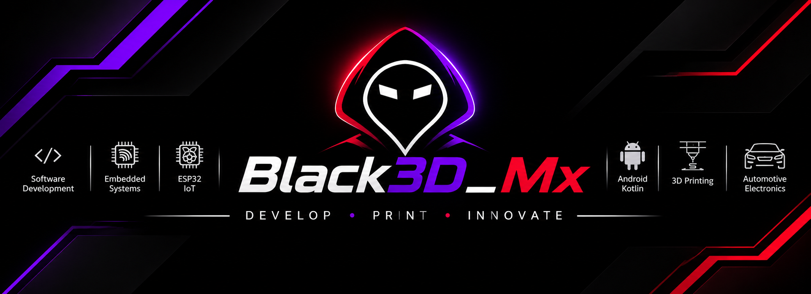

  

# Hi, I'm Khristian! 👋

**Software Development | IoT | Android | Automation**

I'm a developer in progress who enjoys building practical solutions by combining software, hardware and digital fabrication. I turn ideas into functional projects that connect the digital and physical worlds through programming, electronics and 3D printing.

---

## 🚀 Technologies & Tools

| Area | Stack |
|---|---|
| **Languages** | Python · Java · Kotlin · SQL |
| **Mobile** | Android · Android Studio · Kotlin |
| **Hardware & IoT** | ESP32 · Microcontrollers · Electronics |
| **Other** | REST APIs · Automation · 3D Printing · CAD & 3D Modeling |

---

## 🔨 Current Projects & Learning

- 🌦️ **Weather Application**: learning Java, HTTP requests and REST APIs.
- 📱 **Android Applications**: exploring mobile development with Kotlin.
- 📡 **NFC Registration System**: exploring Android and NFC technology.
- ⚡ **ESP32 Projects**: microcontrollers, Python and automation.
- 🖨️ **3D Printing Integration**: combining software, electronics and 3D fabrication.

---

## 🎯 Goals

Build practical applications with Java, Python and Kotlin, develop IoT and automation projects with ESP32, work with databases and REST APIs, and integrate software development with 3D printing.

---

## 📫 Connect with me

- GitHub: [@KhrisRdz](https://github.com/KhrisRdz)
- LinkedIn: [Khristian Rodriguez](https://www.linkedin.com/in/khristian-manuel-rodriguez-cerda-427937226)
- Facebook: [Black3D_Mx](https://www.facebook.com/people/Black3DMx/61570774929642/)
- Email: [Khrisrodced@hotmail.com](mailto:Khrisrodced@hotmail.com)

*
En constante aprendizaje, mejorando mi código y obsesionado con experimentar nuevas tecnologías*
